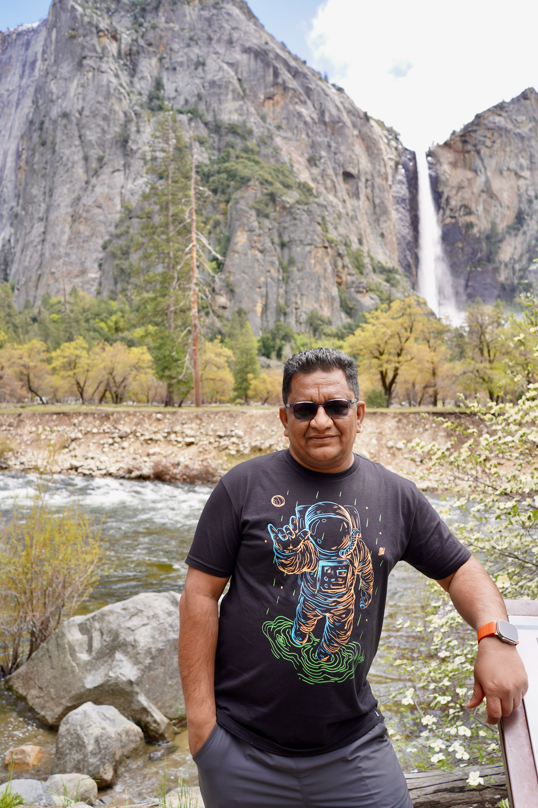

Hi, I’m **Shivprasad Bade** — a backend engineer by profession and a curious mind at heart. I’ve spent over 20 years building scalable, resilient systems that power real-world platforms — but I’ve always believed that life, like code, is more art than algorithm.

When I’m not immersed in architecture diagrams or system logs, I’m exploring films, music, audiobooks, and whatever’s unfolding in the world around us. These threads of creativity, rhythm, and awareness shape how I think, build, and grow.

@ Yosemite Falls May 2024

[Twitter](https://twitter.com/shivprasad) • [GitHub](https://github.com/shivprasad) • [LinkedIn](https://www.linkedin.com/in/shivprasadb)
